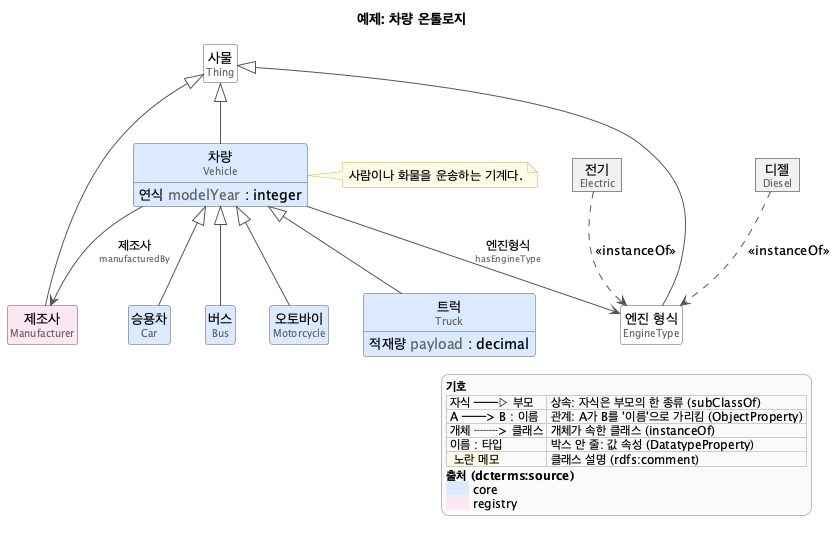

# on2uml

**English** | [한국어](README.ko.md)

Turn an OWL ontology (Turtle `.ttl`) into UML class diagram images. The images are regenerated from the TTL every time. After editing the TTL, rerun the same command and the images are up to date. Rendering is local; the ontology never leaves your machine.



## Install

You need uv, Java 11+, Graphviz and the PlantUML jar.

```bash
git clone https://github.com/Gaebobman/on2uml.git && cd on2uml
uv sync
brew install graphviz                       # Ubuntu: sudo apt install graphviz
mkdir -p ~/.local/share/plantuml
curl -L -o ~/.local/share/plantuml/plantuml.jar \
  https://github.com/plantuml/plantuml/releases/download/v1.2024.7/plantuml-1.2024.7.jar
echo 'export PLANTUML_JAR=~/.local/share/plantuml/plantuml.jar' >> ~/.zshrc && source ~/.zshrc
```

Check: `java -jar "$PLANTUML_JAR" -testdot` → `Installation seems OK` means Java, Graphviz and PlantUML are all ready.

## One diagram

```bash
uv run on2uml examples/vehicle.ttl -o out/truck.png --focus Truck
```

Check: it prints `out/truck.png  (4 classes)` and `out/truck.png` exists.

`--focus` takes a local name (`Truck`), a label (`트럭`) or an IRI. With many classes, one page gets too wide to read. Draw only the neighbourhood of a class (`--focus`, `--depth`), or fold leaf classes into their parent box (`--collapse 3`). All options: `uv run on2uml --help`.

## Recurring work: `views.yaml`

List the diagrams you want in one `views.yaml` and generate them together.

```bash
cp examples/views.yaml <ontology-dir>/views.yaml
uv run on2uml --config <ontology-dir>/views.yaml
```

`<ontology-dir>` is the folder that holds your TTL. In the copied file, set `ontology:` to the TTL file name and replace the class names in `views` (`Truck`, ...) with yours. The available keys are in that file's comments. Add `--only <view-name>` to generate a single view.

Check: each view prints `[<view-name>] <ontology-dir>/out/<view-name>.png  (N classes)`.

`per_class` makes one diagram per class. On the next run only changed diagrams are re-rendered and the changes are printed. Below: the example after deleting `Motorcycle` and adding an attribute to `Bus`.

```text
[per_class] out/classes  (added 0, changed 2, removed 1, unchanged 5)
  changed: Bus, Vehicle
  removed: Motorcycle
```

Changes are counted per image. Editing a superclass also changes the subclass diagrams that show what they inherit. Images of deleted classes are removed. `index.md` in the output folder lists every diagram and the latest changes. Commit `views.yaml` and the output folder to the TTL's repository, and `git diff` on the `.puml` files becomes the diagrams' history.

`--compare <old-ttl>` colours the differences from an older version; in `views.yaml` use the `compare:` key. Get `<old-ttl>` from Git, e.g. `git show <tag>:ontology.ttl > old.ttl`.

Report-only notes, highlight colours and hidden classes go in an overlay YAML (`--overlay`). The TTL is not changed. The format is at the top of [`overlay.py`](src/on2uml/overlay.py).

Named individuals are drawn with `--individuals` (every drawn class) or `--individuals-focus` (the `--focus` classes only). `--individuals-hide CLASS` leaves out the individuals of that exact class, e.g. hundreds of `skos:Concept` values, and wins over focus. In `views.yaml`: `individuals: true | focus` and `individuals_hide: [Concept]`.

## Reading the diagrams

Each diagram has a legend. The legend lists only the notation that diagram uses.

| Diagram | TTL |
|---|---|
| child ──▷ parent | `rdfs:subClassOf` |
| A ──> B : name | `owl:ObjectProperty` (domain → range) |
| `1..*`, `«only»` at the arrow head | `owl:Restriction` (some, min/max/exact, only) |
| `name : type` inside a box | `owl:DatatypeProperty` |
| purple dashed arrow, "…에서 상속" section | relation/attribute inherited from a superclass outside the diagram |
| `«BFO»`, `«IOF»`, grey box | class from a standard ontology (detected by namespace) |

Not drawn: `owl:complementOf`, `owl:oneOf` and nested restrictions print a warning. `owl:disjointWith` and `rdfs:subPropertyOf` are ignored. Text inside the diagrams (legend, section headers) is Korean.

## Keeping ontology data out of this repo

`.gitignore` excludes ontology files, `views.yaml` and rendered output outside `examples/` and `tests/data/`. Keep real ontologies and their diagrams in the ontology's own repository.

## Development

```bash
uv run --group dev pytest
```

## License

[MIT](LICENSE). PlantUML (GPL) is called as a separate process and is not bundled.
